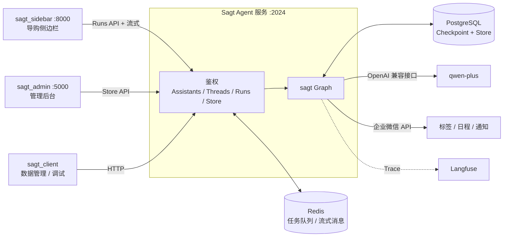
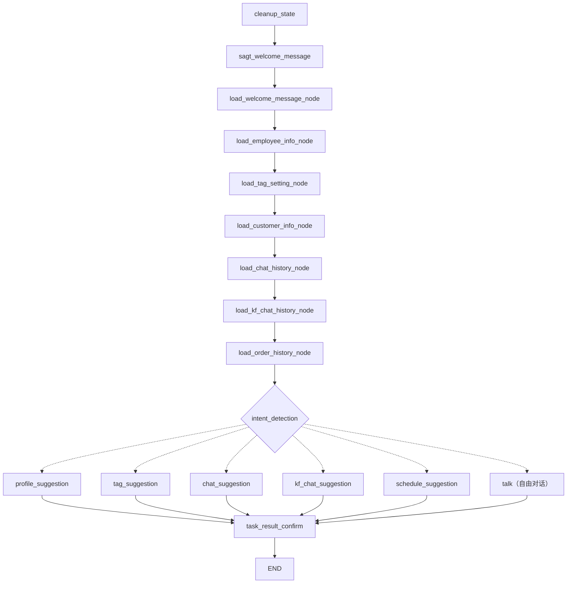
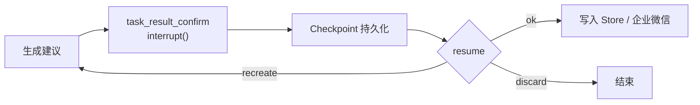
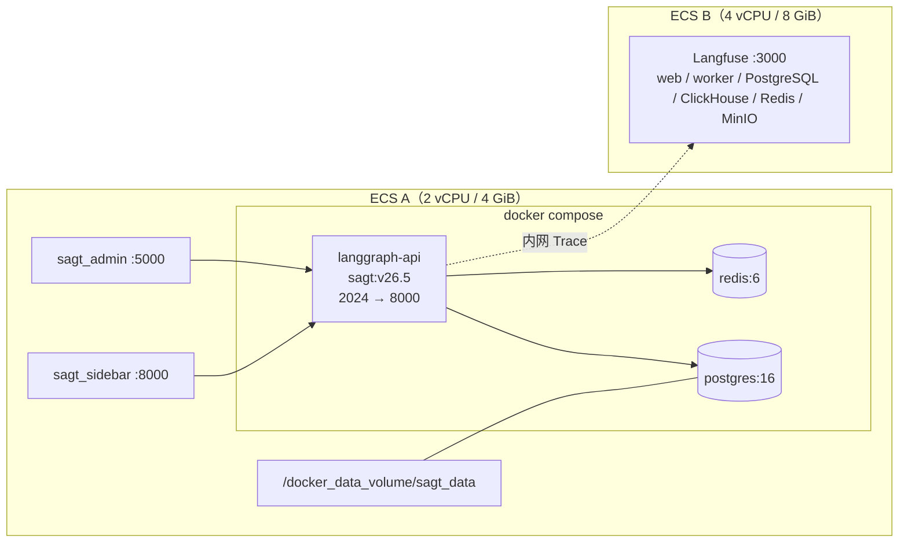

# Sagt：基于 LangGraph 的零售销售多智能体系统

## 项目概述

Sagt 是面向零售行业导购的销售智能体系统。系统聚合单个客户的多源业务数据（客户信息、企业微信会话、微信客服记录、标签体系、微信小店订单），由大模型完成**客户画像、客户标签、聊天建议、客服建议、日程建议**五类任务，并支持自由对话，辅助导购进行客户关系维护，提升销售效率与服务质量。

系统以 **LangGraph** 编排：主图串行加载客户上下文，经**意图识别**通过条件边路由至对应任务子图；对会修改客户档案的任务（画像、标签、日程），在结果确认节点通过 **interrupt 实现人工在环（Human-in-the-Loop）审核**，确认后写入 **LangGraph Store 长期记忆**。执行过程以**流式输出**推送至前端，实时展示各节点进度；服务以 **Docker Compose** 部署（langgraph-api + PostgreSQL + Redis），并通过自建 **Langfuse** 实现全链路可观测。


| 任务   | 子图                    | 输出                                  | 人工确认 | 确认后动作               |
| ---- | --------------------- | ----------------------------------- | ---- | ------------------- |
| 客户画像 | `profile_suggestion`  | 20 余项画像字段（职业、家庭、消费场景、口感偏好、消费频率与金额等） | 是    | 写入 Store 客户档案       |
| 客户标签 | `tag_suggestion`      | 基于全局标签体系的标签推荐                       | 是    | 写入 Store，同步企业微信客户标签 |
| 聊天建议 | `chat_suggestion`     | 下一句回复话术 + 推荐理由                      | 否    | 直接返回                |
| 客服建议 | `kf_chat_suggestion`  | 微信客服渠道回复建议                          | 否    | 直接返回                |
| 日程建议 | `schedule_suggestion` | 从会话中识别约定事项，生成日程时间与内容                | 是    | 创建企业微信日历日程          |
| 自由对话 | `sagt_sub_graph_talk` | 针对侧边栏输入框的自然语言提问，结合客户上下文作答           | 否    | 直接返回                |


**部署方式**：

- **本地开发**：`langgraph dev` 启动 Agent 服务，配合 LangGraph Studio 进行图结构可视化与交互调试
- **Docker Compose**：基于 `langchain/langgraph-api` 构建业务镜像，与 PostgreSQL、Redis 一键编排部署
- **Standalone**：业务镜像以单容器运行，连接独立部署的 PostgreSQL 与 Redis
- **可观测服务**：Langfuse 独立部署于单独的 ECS，接收 Agent 运行 Trace


## 核心模块


### sagt_agent：核心智能分析引擎

**核心职责**：基于客户数据分析，为导购提供智能化的客户关系维护支持。

- **智能聊天建议**：基于客户历史会话与消费偏好，生成个性化沟通话术及推荐理由
- **自动标签标注**：分析客户特征，结合企业标签体系为客户推荐合适的标签
- **智能日程管理**：根据会话中的约定事项，为导购生成日程并创建日历提醒
- **客户画像提取**：深度分析会话与订单数据，生成包含偏好、需求、消费能力等维度的客户 Profile
- **客服建议**：针对微信客服渠道的客户咨询生成回复建议


### sagt_client：智能体 API 客户端

**核心职责**：封装 Sagt 智能体系统 API，提供标准化的数据访问与操作接口。

- **API 封装**：基于 langgraph-sdk 封装 Assistants / Threads / Runs 调用、中断查询与恢复
- **数据管理**：封装 Store 读写，支持智能体数据的读取、写入与更新
- **记忆维护**：初始化与维护客户关系的长期记忆数据


### sagt_admin：智能体管理后台

**核心职责**：提供 Sagt 智能体系统的可视化管理与监控界面。

- **员工管理**：查看授权员工信息
- **客户管理**：查看员工名下客户信息、客户画像与标签
- **会话监控**：查看员工与客户的会话记录和沟通历史
- **服务记录**：查看客户的微信客服交互记录
- **订单管理**：查看客户微信小店订单与购买行为


### sagt_sidebar：导购侧边栏

**核心职责**：提供导购与智能体的交互界面，审核 Agent 操作（人工介入管控）。

- **智能对话界面**：Web 界面，支持导购与智能体进行自然语言交互
- **菜单化操作**：预设客户画像、客户标签、聊天建议、客服建议、日程建议五类业务场景
- **自由提问**：输入框支持自然语言提问，由意图识别分派至对应任务或自由对话
- **实时流式响应**：实时展示智能体各执行阶段与结果
- **中断确认机制**：当智能体需要人工决策时提供确认界面，支持确认、放弃、重新生成


## 技术栈


| 环节       | 工具                                                                                      |
| -------- | --------------------------------------------------------------------------------------- |
| Agent 编排 | LangGraph（StateGraph、子图、条件边、reducer、interrupt / Command）                                |
| Agent 服务 | LangGraph Server（`langgraph dev` / `langgraph-api` 镜像）、自定义鉴权 `auth.py`、扩展路由 `webapp.py` |
| 大模型      | 通义千问 qwen-plus（DashScope OpenAI 兼容接口）                                                   |
| 结构化输出    | Pydantic（JSON Schema + 示例注入 Prompt）                                                     |
| 记忆       | Checkpointer（线程级短期记忆）、Store（跨会话长期记忆）                                                    |
| 持久化与队列   | PostgreSQL 16（Checkpoint / Store 持久化）、Redis 6（任务队列与流式消息）                                |
| 客户端      | langgraph-sdk（Assistants / Threads / Runs / Store API）                                  |
| 管理后台     | Flask + Jinja2                                                                          |
| 侧边栏      | FastAPI（StreamingResponse）+ 原生 HTML / CSS / JavaScript                                  |
| 可观测性     | Langfuse（自建）、LangSmith、LangGraph Studio                                                 |
| 外部集成     | 企业微信 API（客户标签 `mark_tag`、日程 `oa/schedule/add`、应用消息通知）                                   |
| 部署       | Docker、Docker Compose、uv                                                                |
| 运行环境     | 阿里云 ECS（Agent：2 vCPU / 4 GiB；Langfuse：4 vCPU / 8 GiB），Alibaba Cloud Linux 3             |


## 系统架构


### 整体架构




### Agent 主图




实线为普通边，虚线为条件边。各任务均实现为子图（如 `profile_suggestion` 内部为 `profile_welcome_node → profile_generate_node`），子图事件以 `values|<subgraph>:<id>` 命名空间推送至客户端。新增任务类型只需新增子图并注册路由。

### 人工在环审核流程




中断载荷包含任务说明及新旧数据对比（如 `old_profile` / `new_profile`）；客户端通过 `Command(resume=...)` 在同一 thread 上恢复执行。状态持久化于 PostgreSQL，审核可异步完成，不依赖请求进程存活。

### 部署架构




- 业务镜像 `sagt:v26.5` 以 `langchain/langgraph-api:3.12-wolfi` 为基础镜像，打包 `src/` 及依赖，并通过 `LANGSERVE_GRAPHS`、`LANGGRAPH_HTTP` 注册图与扩展路由
- PostgreSQL 数据目录挂载至宿主机卷，容器重建后记忆数据不丢失
- Langfuse 资源占用较高（ClickHouse 等组件），独立部署于单独实例，经内网接收 Trace，客户数据不出私有网络


## 目录结构

```
sagt-sales-agent/
├── sagt_agent/                     # Agent 服务
│   ├── src/
│   │   ├── graphs/sagt_graph/      # 主图（sagt_graph.py）、State、加载节点及 6 个子图
│   │   │   ├── sagt_sub_graph_profile/
│   │   │   ├── sagt_sub_graph_tag/
│   │   │   ├── sagt_sub_graph_chat_suggestion/
│   │   │   ├── sagt_sub_graph_kf_chat_suggestion/
│   │   │   ├── sagt_sub_graph_schedule/
│   │   │   └── sagt_sub_graph_talk/
│   │   ├── llm/                    # 意图识别、各任务生成与自由对话的 Prompt 及模型调用
│   │   ├── models/                 # Pydantic 结构化输出模型（SagtBaseModel）
│   │   ├── store/                  # Store 访问封装
│   │   ├── tools/                  # Store 工具、企业微信工具
│   │   ├── utils/                  # 日志、时间格式化、调试切面
│   │   ├── auth/                   # 自定义鉴权
│   │   └── webapp/                 # 扩展 HTTP 路由
│   ├── test/llm_test/            # 意图识别、各任务生成及 Schema 的单元测试
│   ├── langgraph.json              # 图注册、鉴权、扩展路由、运行时配置
│   ├── sagt.dockerfile             # 业务镜像构建
│   ├── docker-compose.yml          # langgraph-api + PostgreSQL + Redis 编排
│   └── .env.example
├── sagt_client/                    # 客户端 SDK 与调试脚本
│   ├── agent_client/               # 任务调用、中断查询与恢复
│   └── store_client/               # Store 读写、数据初始化
│       └── data/
├── sagt_admin/                     # 管理后台（Flask）
│   ├── sagt_store_api/
│   ├── templates/
│   ├── static/
│   └── sagt_admin_app.py
└── sagt_sidebar/                   # 导购侧边栏（FastAPI）
    ├── sagt_agent_api/
    ├── sagt_web/                   # index.html / app.js / styles.css
    └── sagt_sidebar_app.py
```

四个模块均为独立的 uv 项目，分别维护依赖与 `.env`。

## 核心功能


### 1. 客户上下文加载

主图前段由 6 个加载节点依次将员工信息、全局标签体系、客户信息、企业微信会话、微信客服记录、微信小店订单写入 State，供下游子图共享，避免重复查询。各节点向 `node_result` 追加执行记录（节点名、结果码、提示信息、异常列表），该字段采用追加型 reducer，形成可追溯的执行轨迹。

### 2. 意图识别与子图路由

`intent_detection` 判定任务类型，经条件边分派至对应子图。各子图结构一致（提示节点 → 生成节点），输出统一的结果结构：

```json
{
  "task_result": "...",
  "task_result_explain": "...",
  "task_result_code": 0
}
```


### 3. 结构化输出

各类结果以 Pydantic 模型定义，基类提供 `get_schema_json()` 与 `get_example_json()`。调用大模型时将 JSON Schema 与示例注入 Prompt，并约束"仅返回合法 JSON、不包含代码块标记、不含未定义字段"，保证输出可被稳定解析并直接用于展示与持久化。

### 4. 人工在环审核

画像、标签、日程类任务在 `task_result_confirm` 触发 `interrupt()`，提供完整的审核描述与新旧数据对比，并约定 resume 数据结构：

- `ok`：确认，写入 Store；标签通过企业微信 `mark_tag` 同步（使用应用自建规则组下的标签），日程通过 `oa/schedule/add` 创建，并以应用消息通知导购
- `discard`：放弃
- `recreate`：返回生成节点重新生成

聊天建议、客服建议为只读建议，不修改数据，直接返回结果。

### 5. 长期记忆数据模型

Store 采用 `namespace + key + value` 组织数据：


| 数据      | namespace                           | key           |
| ------- | ----------------------------------- | ------------- |
| 客户信息与画像 | `["external_user", follow_user_id]` | `external_id` |
| 标签体系    | `["tags_setting"]`                  | `tag_id`      |
| 企业微信会话  | `["wxqy_msg", from_to_sorted_key]`  | `msg_id`      |
| 微信客服消息  | `["wxkf_msg", external_id]`         | `msg_id`      |
| 微信小店订单  | `["wxxd_order", union_id]`          | `order_id`    |


- **多租户隔离**：客户数据按导购 ID 划分 namespace
- **跨系统身份关联**：企业微信 `external_userid` 与微信小店 `openid` 分属不同身份体系，通过 `unionid` 关联订单与客户
- **幂等写入**：以业务主键作为 key，重复同步即覆盖，不产生重复数据


### 6. Assistant 与 Thread 管理

以 `{graph_id}_{user_id}_{external_id}` 生成稳定的 UUID 作为 `assistant_id`，创建时将导购与客户写入 `configurable` 配置（`if_exists="do_nothing"`），实现"一个导购 × 一个客户"对应一个固定 Assistant；thread 与业务实体映射，便于检索和恢复未完成的中断。

### 7. 流式输出

客户端以 `values` 模式订阅运行过程（含子图事件），每个节点完成后推送当前 State，侧边栏据此实时渲染加载、生成、待确认等阶段。

### 8. 可观测性

Agent 接入自建 Langfuse，记录每次运行的完整调用树：各节点耗时、发送给大模型的 Prompt、模型输出与 token 用量，用于定位慢节点、排查输出异常与评估成本。开发阶段同时支持 LangSmith Tracing 与 LangGraph Studio 可视化调试。

### 9. 侧边栏运行模式

生产环境中侧边栏挂载于企业微信聊天工具栏，经 JS-SDK 获取当前会话客户；脱离企业微信时以配置的演示客户 ID 在浏览器中独立运行，便于开发调试与演示。

## 技术架构特点

- **模块化设计**：Agent 服务、客户端、管理后台、侧边栏四个模块独立开发与部署；任务以子图形式扩展，新增能力不影响主流程
- **智能体记忆**：基于 LangGraph Checkpointer 与 Store 实现短期执行状态与长期客户记忆的分层管理，PostgreSQL 持久化
- **API 封装**：基于 LangGraph Server 对外提供统一的鉴权 HTTP 接口，客户端 SDK 统一封装调用，便于系统集成
- **人工在环可控**：按操作风险分级，只读建议直接返回，写操作必须经人工确认，兼顾效率与业务安全
- **可观测**：Trace 全链路记录，可观测服务私有化部署，满足客户数据不出域的合规要求


## 运行效果


| 指标   | 结果                                                              |
| ---- | --------------------------------------------------------------- |
| 图规模  | 9 个准备 / 加载节点 + 意图识别 + 6 个子图（5 类任务 + 自由对话）+ 1 个确认节点              |
| 演示数据 | 1 名导购、1 名客户、8 笔微信小店订单及对应会话与客服记录                                 |
| 聊天建议 | 全部加载节点 `execute_result_code = 0`，结合会话与历史偏好生成话术及推荐理由，无中断直接返回     |
| 客户画像 | 生成 20 余项画像字段；interrupt 返回新旧画像对比，`resume` 确认后写入 Store，管理后台客户详情可见 |
| 人工在环  | 中断查询与确认写入通过命令行（`get_interrupt` / `resume_interrupt`）及侧边栏按钮验证    |
| 资源   | Agent、管理后台、侧边栏三个服务同时运行于 2 vCPU / 4 GiB ECS                      |


## 快速开始


### 1. 环境准备

```bash
# Python 3.12 + uv
curl -LsSf https://astral.sh/uv/install.sh | sh

git clone https://github.com/JingweiYang-Nina/sagt-sales-agent.git
cd sagt-sales-agent
```


### 2. 配置

```bash
cp sagt_agent/.env.example   sagt_agent/.env     # API_KEY、DEMO_USER_*、LANGSMITH_* / LANGFUSE_*、IMAGE_NAME
cp sagt_client/.env.example  sagt_client/.env    # SAGT_SERVER_URL、SAGT_USER_ID / PASSWORD
cp sagt_admin/.env.example   sagt_admin/.env     # ADMIN_USER_ID / PASSWORD
cp sagt_sidebar/.env.example sagt_sidebar/.env   # WEB_USER_ID / PASSWORD
```

client、admin、sidebar 访问 Agent 的凭据需与 `sagt_agent/.env` 中的 `DEMO_USER_ID` / `DEMO_USER_PASSWORD` 一致。LangSmith 账号不在默认 US 区域时需配置 `LANGSMITH_ENDPOINT`。

### 3. 启动 Agent 服务

**方式一：本地开发**

```bash
cd sagt_agent
uv sync
uv run langgraph dev --host 127.0.0.1 --port 2024
# Studio: https://smith.langchain.com/studio/?baseUrl=http://127.0.0.1:2024
```

**方式二：Docker Compose 部署**

```bash
cd sagt_agent
docker build -f sagt.dockerfile -t sagt:v26.5 .     # 构建业务镜像（与 .env 中 IMAGE_NAME 一致）
docker compose up -d                                # 启动 langgraph-api + PostgreSQL + Redis
docker compose logs -f                              # 查看日志
# docker compose down                               # 停止
```

**方式三：Standalone 部署**（使用独立的 PostgreSQL 与 Redis）

```bash
# .env 中配置 DATABASE_URI 与 REDIS_URI
docker run -d --rm --name sagt --env-file .env -p 2024:8000 sagt:v26.5
docker logs -f sagt
```


### 4. 部署 Langfuse（可选）

```bash
# 在独立实例上
cd sagt-langfuse
docker compose up -d                # http://<langfuse-host>:3000，创建组织、项目并生成 Key
```

在 `sagt_agent/.env` 中启用：

```bash
LANGFUSE_ENABLED=true
LANGFUSE_PUBLIC_KEY=pk-lf-xxx
LANGFUSE_SECRET_KEY=sk-lf-xxx
LANGFUSE_BASE_URL=http://<langfuse-内网IP>:3000
```


### 5. 初始化数据与调试

```bash
cd sagt_client
uv sync

cd store_client
uv run sagt_demo_init.py              # 写入演示数据
uv run sagt_store_test.py             # 查看 Store

cd ../agent_client
uv run sagt_agent_test.py chat        # 聊天建议
uv run sagt_agent_test.py profile     # 客户画像（触发中断）
uv run sagt_agent_test.py get_interrupt
uv run sagt_agent_test.py resume_interrupt                # 确认
# uv run sagt_agent_test.py resume_confirmed discard      # 放弃
# uv run sagt_agent_test.py resume_confirmed recreate     # 重新生成
uv run sagt_agent_test.py schedule    # 日程建议
```


### 6. 启动管理后台与侧边栏

```bash
cd sagt_admin && uv sync && uv run sagt_admin_app.py        # http://localhost:5000
cd sagt_sidebar && uv sync && uv run sagt_sidebar_app.py    # http://localhost:8000/sagt_web/login.html
```


## 项目中遇到的问题与解决


### 1. 国内服务器拉取 Docker 镜像阻塞

服务器位于杭州，Docker Hub 直连不可用，`daemon.json` 中三个公共加速源被顺序轮询，其中一个已失效，导致 `docker pull` 长时间停留在 `Waiting` / `Retrying`。我通过 `curl` 请求各加速源的 `/v2/` 接口，按返回码（401 可用、000 不可达）筛选可用源，改为以加速源前缀显式拉取后 `docker tag` 回标准名称；对体积较大的 langgraph-api 基础镜像使用 `nohup` 后台循环自动重试。改进方向：使用云厂商私有镜像仓库或预先导出离线镜像包。

### 2. 客户端鉴权失败（"获取 token 失败"）

Agent 服务启用自定义鉴权，客户端需以账号密码换取 token。排查发现 `sagt_client/.env` 中的凭据与 `sagt_agent/.env` 的 `DEMO_USER_ID` / `DEMO_USER_PASSWORD` 不一致；统一后鉴权通过。同时修正演示数据的归属导购 ID，否则数据写入其他导购的 namespace，侧边栏与后台均无法查询。改进方向：各模块共享基础配置，并在启动时执行鉴权自检。

### 3. LangSmith 追踪与 Studio 版本限制

LangSmith 账号位于 APAC 区域，SDK 默认上报至 US 区域，需显式配置 `LANGSMITH_ENDPOINT`；`.env` 仅在服务启动时加载，修改后需重启。Studio 的 "API key missing" 提示实际由 `LANGSMITH_TRACING=false` 触发；"Studio tracing 需要 langgraph-api ≥ 0.11" 源于依赖锁定在 0.6.9。为保证兼容性未升级依赖，Trace 改由 LangSmith 控制台及自建 Langfuse 查看。

### 4. 脱离企业微信运行侧边栏

侧边栏生产环境依赖企业微信 JS-SDK 获取当前会话客户的 `external_id`。在企业微信不可用的情况下，以配置的演示客户 ID 替代该上下文，侧边栏在浏览器中独立运行，五类任务与审核流程均完整验证。改进方向：将会话上下文抽象为可替换的 Provider，分别适配企业微信、浏览器调试及其他 IM 渠道。

### 5. 2 vCPU / 4 GiB 服务器内存受限

服务器上运行着其他项目的 Milvus 相关容器，远程开发环境还残留一个旧的扩展宿主进程（约 1 GB）。停止旧容器并将重启策略改为 `no`、清理残留进程后，已用内存由 1.8 GB 降至 1.2 GB；之后采用单编辑器窗口 + 多终端运行各模块，避免每个窗口额外占用约 500 MB。Langfuse 因 ClickHouse 等组件资源占用较高，单独部署于 4 vCPU / 8 GiB 实例。改进方向：为容器设置内存上限并配置 SWAP，防止 OOM。

### 6. 密钥管理

上游代码将 `.env` 纳入版本控制，`.env.example` 中残留真实企业 ID。发布时使用全新提交历史，`.env` 加入 `.gitignore`，示例文件敏感值替换为占位符，并在提交前通过 `grep` 按密钥前缀扫描，确保无密钥入库。

## About

基于 LangGraph 的零售销售多智能体系统：意图识别路由 6 个子图（客户画像 / 客户标签 / 聊天建议 / 客服建议 / 日程建议 / 自由对话），Pydantic 结构化输出，Store 长期记忆管理客户画像与订单，interrupt 人工在环审核后写入并同步企业微信；Docker Compose 部署（langgraph-api + PostgreSQL + Redis），自建 Langfuse 可观测。